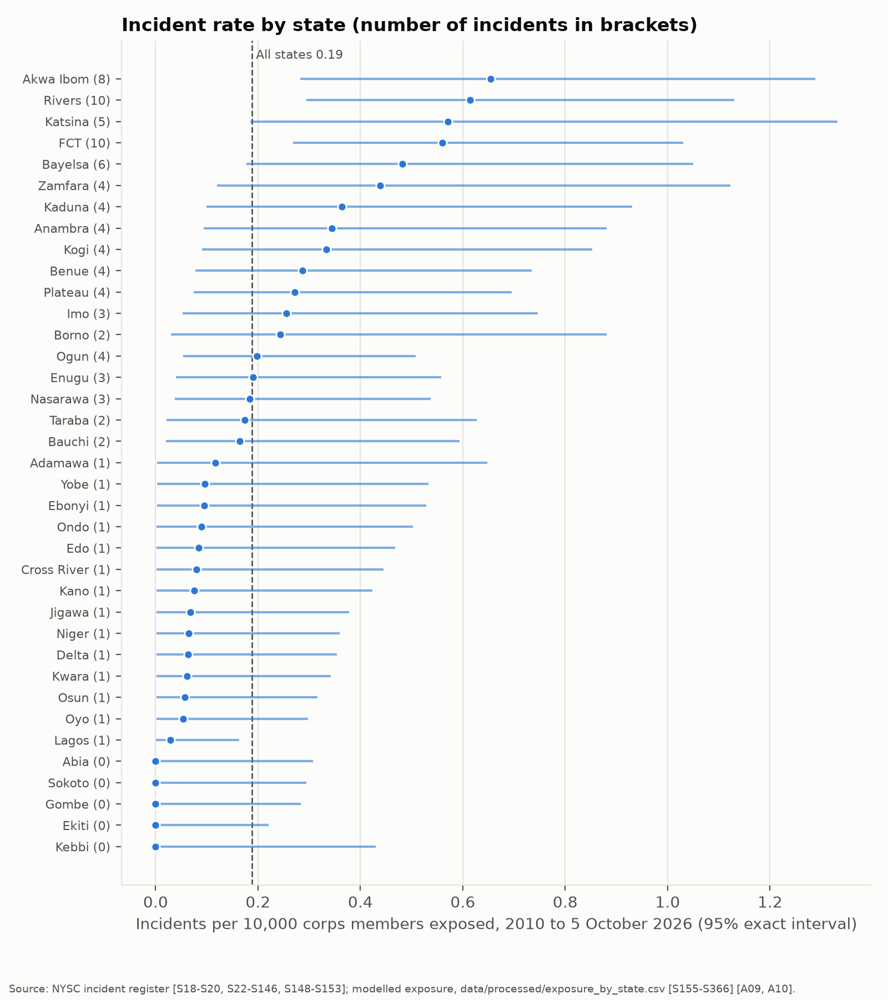
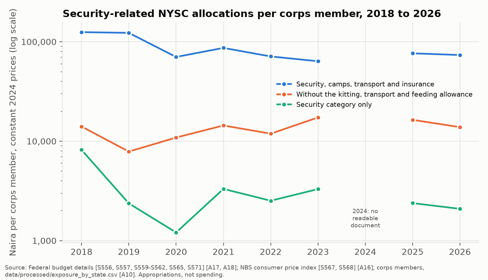

# Duty of Care to NYSC Corps Members in an Era of Insecurity

   

An assessment of how far the rules and resources of the National Youth Service Corps (NYSC) protect corps members from kidnapping and other serious harm, and of where in the service year and in which states the risk is highest.

Status, 9 October 2026: policy audit, incident register, the tests of H1 to H4 and the budget audit (H5) are complete.

## Findings

The register holds 96 incidents of serious harm to prospective and serving corps members from April 2011 to 1 October 2026, coded from an archive search of 6,364 articles in Premium Times, Daily Trust and Channels Television and targeted searches of other outlets (`data/processed/incidents.csv`; source IDs per incident). They comprise 35 kidnappings, 23 killings, 18 road crashes, 9 physical assaults, 3 robberies, 3 sexual-violence incidents and 5 other harms, in which 151 corps members were abducted and 65 killed. Results are reported for 1 January 2010 to the data cutoff of 5 October 2026 [A15].

| Question | Result | Detail |
|----------|--------|--------|
| Duty-of-care scorecard | The current framework scores 12 of 36 (33.3%) against the Global Interagency Security Forum standard [S01, S02]; the June 2026 reform as announced raises this to 14 of 36 (38.9%). Informed consent, incident reporting and crisis and kidnap response score 0 under both. | [`docs/policy_audit.md`](docs/policy_audit.md) |
| H1 Salience gap | Not supported. Incidents in the North West and North East received a median of 1 article each, the same as incidents in the southern zones (one-sided Mann-Whitney p = 0.553). | [`notebooks/02_incidents.ipynb`](notebooks/02_incidents.ipynb) |
| H2 Travel window | Supported. 11 of 21 day-dated incidents in the travel and camp stages (52.4%) fell within 7 days of a camp-opening or passing-out date, against 30.6% of calendar days in such windows (one-sided exact binomial p = 0.030). For 2016 to 2026 alone, p = 0.067. | [`notebooks/02_incidents.ipynb`](notebooks/02_incidents.ipynb) |
| H3 Exposure-adjusted risk | Supported. Incident rates per 10,000 corps members differ across states (Poisson likelihood-ratio 90.2, df 36, p = 0.000002). Highest rates: Akwa Ibom 0.65, Rivers 0.61, Katsina 0.57, FCT 0.56 and Bayelsa 0.48 per 10,000 [A09, A10]. Rankings by rate are close to rankings by count (Spearman 0.96). | [`notebooks/03_risk.ipynb`](notebooks/03_risk.ipynb) |
| H4 Relative risk | Supported. State incident rates for corps members correlate with general kidnapping rates per 100,000 population from a news series coded the same way (Spearman rho 0.38, 95% interval 0.05 to 0.65, one-sided p = 0.010, 37 states) [S555, A12-A14]. The secondary comparison with Nigeria Watch fatal kidnapping events shows no clear association (rho 0.12, p = 0.23) [S10]. | [`notebooks/03_risk.ipynb`](notebooks/03_risk.ipynb) |
| H5 Resources | Holds on the eight years covered; 2024 is missing. Security-related NYSC allocations per corps member fell in real terms from 124,917 naira in 2018 to 73,551 naira in 2026 (constant 2024 naira, 41% lower) [S556, S557, S559-S562, S565, S567, S568, S571] [A16-A18]. Most of this measure is the corps members' kitting, transport and feeding allowance; without it the figure is flat (14,045 and 13,846 naira), and the security category alone fell from 8,190 to 2,088 naira. 2024 is reported as missing because its signed Act is a scan without a text layer and no other published 2024 document lists the approved NYSC lines. Figures are appropriations, not spending. | [`notebooks/04_budget.ipynb`](notebooks/04_budget.ipynb) |

The interactive dashboard (`app/streamlit_app.py`) shows the incident map and table, state rates, the scorecard and the travel-window chart.

All charts: [`reports/figures/`](reports/figures/). Policy brief: [`reports/policy_brief.md`](reports/policy_brief.md).

## Questions

1. How far do the NYSC Act, bye-laws, directives and the June 2026 reform package meet the duty-of-care standard published by the Global Interagency Security Forum?
2. Where, when and at which stage of the service year are corps members harmed, and does public attention follow the incidents?
3. Which states carry the highest risk once the number of corps members deployed is taken into account, and does that risk track general kidnapping?
4. Did security-related NYSC funding per corps member change in real terms between 2018 and 2026?

Hypotheses H1 to H5 and their tests are fixed in [`docs/preregistration.md`](docs/preregistration.md).

## Method

| Phase | Method | Main output |
|-------|--------|-------------|
| 1 | Policy audit: 12-criterion duty-of-care scorecard, scored for the framework before and after the June 2026 reform | `docs/policy_audit.md` |
| 2 | Incident register, 2010 to 2026, coded from national news outlets with AI assistance under a published coding protocol, with a coding note for each incident | `data/processed/incidents.csv` |
| 3 | Salience gap, travel-window test, exposure-adjusted rates and comparison with general kidnapping (Nigeria Watch and a news series coded the same way) | Notebooks 02 and 03 |
| 4 | Budget audit, 2018 to 2026, in constant 2024 naira | Notebook 04, `data/processed/budget_lines.csv` |

Full plan and limitations: [`docs/analysis_plan.md`](docs/analysis_plan.md).

## Repository

| Path | Contents |
|------|----------|
| `docs/` | Analysis plan, pre-registration, coding protocol, policy audit, source log, assumptions and data conflicts |
| `data/raw/`, `data/interim/`, `data/processed/` | Downloads, working files and analysis-ready data |
| `src/nysc_safety/` | Python package: archive search, coding scheme validation, register build, rates, travel-window test, scorecard and its sensitivity check |
| `tests/` | pytest tests |
| `notebooks/` | Numbered analysis notebooks |
| `reports/` | Figures, result tables, policy brief and maps |
| `app/` | Streamlit dashboard |
| `docs/reproduce.md` | Setup and commands to rebuild the results |

## Standards

Every figure carries a source ID that matches [`docs/sources.md`](docs/sources.md). Disagreements between sources are logged in [`docs/data_conflicts.md`](docs/data_conflicts.md), and assumptions in [`docs/assumptions.md`](docs/assumptions.md). Victim names are not stored, in line with the Nigeria Data Protection Act 2023: URLs and headlines of the article indexes are kept in local, git-ignored `headlines/` folders and rebuilt by the archive search, while URLs of articles cited as evidence are kept as citations (`nysc_safety.headlines`; `docs/analysis_plan.md`, section 10).

## Reproducing the results

Setup and the commands that rebuild every dataset, table and chart are in [`docs/reproduce.md`](docs/reproduce.md). The test suite runs with `pytest`.

## Licence

Code is released under the [MIT License](LICENSE). Data, the policy brief, charts and other documents are released under [Creative Commons Attribution 4.0](https://creativecommons.org/licenses/by/4.0/); reuse is permitted with credit. Primary documents and news articles cited in [`docs/sources.md`](docs/sources.md) remain the property of their publishers.

## Citation

Badmus, M. (2026). *Duty of Care to NYSC Corps Members in an Era of Insecurity*. GitHub repository, https://github.com/malikbadmus79-max/nysc-duty-of-care. Machine-readable citation: [`CITATION.cff`](CITATION.cff).

## Author

Malik Badmus, BSc Sociology, University of Ilorin. [GitHub](https://github.com/malikbadmus79-max) · [LinkedIn](https://linkedin.com/in/malik-badmus)
