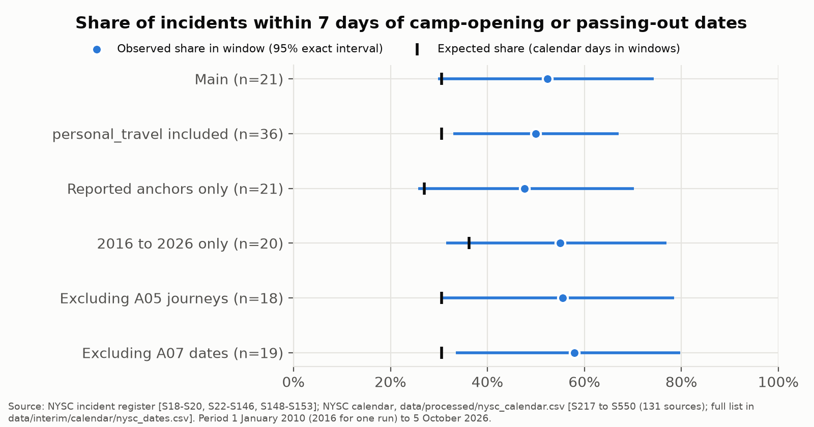
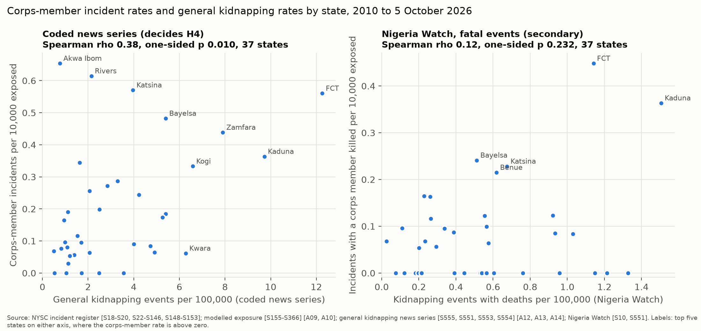
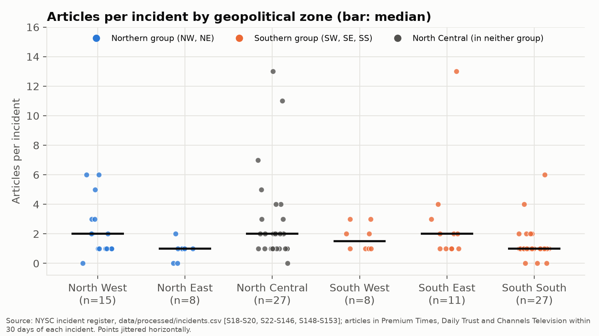

# Duty of Care to NYSC Corps Members: Evidence for the 2026 Reform

Policy brief for the Federal Ministry of Youth Development, the Directorate of the National Youth Service Corps (NYSC), and the Committees on Youth Development of the Senate and the House of Representatives.

October 2026. Data cutoff: 5 October 2026.

## Summary

- From April 2011 to October 2026, national news reports record 96 incidents of serious harm to prospective and serving corps members, in which 151 corps members were abducted and 65 killed. Kidnapping is the most common harm (35 incidents).
- Measured against the duty-of-care standard of the Global Interagency Security Forum, current NYSC rules score 12 of 36. The reform approved by the Federal Executive Council in June 2026 raises this to 14 of 36 as announced. Informed consent, incident reporting and crisis and kidnap response score 0 under both.
- Incidents cluster around official travel dates. Among incidents on journeys to and from camp and in camp, 52% occurred within 7 days of a camp-opening or passing-out date, against 31% of calendar days in such windows.
- Risk differs by state once the number of corps members deployed is taken into account. States with more kidnapping of the general population tend to have higher incident rates for corps members, but the link is moderate, and several high-risk states for corps members are not high-kidnapping states.
- Security-related NYSC budget allocations per corps member fell by 41% in real terms between 2018 and 2026, on the eight years for which the approved budget can be read (2024 is missing). Most of these allocations are the corps members' kitting, transport and feeding allowance; the lines for security itself, such as security services, cameras and life jackets, fell from about 8,200 to 2,100 naira per corps member in 2024 prices.

## Background

The NYSC deploys about 400,000 graduates a year to every state [S160]. Corps members travel between states to orientation camps, from camps to places of primary assignment, and home at the end of service. On 26 August 2026, two months after the reform was approved, 16 corps members returning from the Bayelsa orientation camp were abducted in Ofu Local Government Area, Kogi State, and later rescued [S18, S19]. The reform package announces civilian leadership, a six-week orientation, risk-sensitive deployment and the certification of camps [S04, S05, S21]. Its legal text was not available at the time of the audit [S06].

This brief summarises an independent assessment with four parts: an audit of NYSC rules against a recognised duty-of-care standard; a register of incidents of serious harm, 2010 to 2026, coded from news reports; pre-registered tests of when and where corps members face the highest risk; and an audit of NYSC budget allocations from 2018 to 2026. Methods, data and code are public in the project repository. The analysis plan and tests were fixed and time-stamped before outcome data were analysed.

## Findings

### 1. The rules do not set out a duty of care for most risks

The NYSC Act, the 1974 and 2011 Bye-laws and the published Director-General directives were scored on 12 criteria derived from the duty-of-care obligations of the Global Interagency Security Forum [S01, S02]. Each criterion was scored from 0 (no provision) to 3 (a procedure and a responsible office covering all stages of the service year).

| Criterion | Current rules | Reform as announced |
|-----------|---------------|---------------------|
| Governance and accountability | 2 | 2 |
| Risk assessment of states, routes and places of assignment | 0 | 1 |
| Risk-informed deployment, redeployment and exemption | 1 | 1 |
| Informed consent and pre-deployment risk information | 0 | 0 |
| Travel management | 2 | 2 |
| Security at orientation camps | 1 | 2 |
| Security at places of primary assignment | 2 | 2 |
| Security awareness and training | 1 | 1 |
| Incident reporting and recording | 0 | 0 |
| Crisis management and kidnap response | 0 | 0 |
| Post-incident support, insurance and compensation | 2 | 2 |
| Review, learning and public reporting | 1 | 1 |
| Total (of 36) | 12 | 14 |

Source: project scorecard (`docs/policy_audit.md`) [S01-S03, S11, S21]. If every borderline score moved one point, the current total would range from 7 to 17 and the reform total from 9 to 19; the three criteria scored 0 are unaffected.

Three gaps stand out. No rule gives corps members information about the risks of a posting or a route before deployment, and refusing a posting is penalised (2011 Bye-laws, paragraphs 3(20) and 12) [S11]. No procedure exists for recording or reporting incidents, and addressing the press on NYSC policy is a disciplinary offence (paragraph 3(18)) [S11]. No crisis management or kidnap response plan is published; the response to the 2026 Kogi abduction relied on the police and the armed forces [S18, S19]. Local Government Committees collect corps members from camp within the state of service (NYSC Act, section 8(3)(b)) [S03], but no procedure covers journeys between states, where the 2026 Kogi abduction took place.

### 2. Travel to and from camp is the period of concentrated risk

Of the 96 incidents, 23 occurred in camp or on journeys to or from camp, and a further 23 on personal journeys. Among the 21 incidents in the camp and travel stages with an exact date, 11 (52%) fell within 7 days of an official camp-opening or passing-out date. Such windows cover 31% of calendar days from 2010 to 2026, so incidents in these stages were about 1.7 times as frequent in the travel windows as their share of days (one-sided exact binomial test, p = 0.030). The result holds when personal journeys are included (18 of 36, p = 0.011). The sample is small, and for 2016 to 2026 alone the excess is similar in size but not statistically significant (p = 0.067).

### 3. Risk differs by state, and only partly follows general kidnapping

Incident rates were calculated per 10,000 corps members deployed to each state, using a model of deployment built from 208 reported orientation-course sizes and national totals [A09, A10]. Rates differ across states (Poisson likelihood-ratio test, p = 0.000002). The highest rates are in Akwa Ibom (0.65 per 10,000), Rivers (0.61), Katsina (0.57), the Federal Capital Territory (0.56) and Bayelsa (0.48). Five states have no recorded incident. Intervals are wide for most states.

State rates for corps members are positively associated with rates of general kidnapping per 100,000 population, measured from a series of 6,440 kidnapping events coded from the same news outlets (Spearman rho = 0.38, 95% interval 0.05 to 0.65, p = 0.010) [S555, A12-A14]. The Federal Capital Territory, Kaduna and Zamfara rank high on both. Akwa Ibom and Rivers rank highest for corps members but low for general kidnapping, while Kwara and Niger show the reverse. Deployment decisions based only on general insecurity indicators would therefore miss part of the risk to corps members.

### 4. Security-related funding per corps member fell in real terms

NYSC line items were taken from the federal budget details for 2018 to 2026 and classified as security-related when their description refers to security, orientation camps, transport or insurance [A18]. Amounts were converted to 2024 prices with the National Bureau of Statistics consumer price index [S567, S568] [A16] and divided by the number of corps members in each year [A10]. 2024 is reported as missing, because the signed 2024 Act is published only as a scan without a text layer and no other published 2024 document lists the approved NYSC lines [S563, S572]. The finding below holds on the eight years covered: no covered year exceeds the 2018 value of the main measure.

| Measure, naira per corps member in 2024 prices | 2018 | 2026 | Change |
|-----------------------------------------------|------|------|--------|
| Security, camps, transport and insurance lines | 124,917 | 73,551 | -41% |
| The same, without the kitting, transport and feeding allowance | 14,045 | 13,846 | -1% |
| Security lines only | 8,190 | 2,088 | -75% |

No 2024 values: the 2024 budget document has no text layer.

Source: federal budget details [S556, S557, S559-S562, S565, S571] [A17]. Figures are appropriations, not releases or spending.

In nominal terms these lines tripled, from 13.1 billion naira in 2018 to 40.7 billion naira in 2026, but prices rose about fourfold and the number of corps members by about a third. The corps members' kitting, transport and feeding allowance makes up 81% to 89% of the measure. The lines for security itself are small: a recurrent "security charges" line of 1.1 billion naira in 2026, and capital items such as life jackets, cameras and watch towers worth tens of millions of naira a year. An insurance premium line has stayed at 1.25 billion naira a year since 2021, so its real value per corps member has fallen by about 70%. The security-related share of the NYSC allocation fell from 12.5% in 2018 to 8.4% in 2026.

### 5. Public attention does not differ by region

Incidents in the North West and North East received the same median number of news articles (one) as incidents in the southern zones (Mann-Whitney test, p = 0.553). The hypothesis of a regional gap in attention was not supported. This test covers only incidents that were reported at all; incidents never reported are outside the register.

## Recommendations

The recommendations below follow from the gaps found and are addressed to the bodies that can act on them.

1. Set out the duty of care in the amended NYSC Act. The amendment directed by the reform package gives the National Assembly the opportunity to name an office responsible for corps member safety and to require the Directorate to report annually on harm to corps members, by state, stage of service and type of harm.
2. Publish a travel safety procedure covering journeys between states. The Directorate could coordinate departure times, routes and escorts for journeys to and from camp, with particular attention to the 7 days around camp-opening and passing-out dates, and extend the duty of Local Government Committees beyond the state of service.
3. Base risk-sensitive deployment on exposure-adjusted data. The risk assessment announced in the reform could use incident rates per corps member deployed, alongside general security indicators, since the two rank states differently. The method and the responsible office could be published.
4. Give corps members risk information and a route to relocation. A pre-deployment briefing on the risks of the state and route, and a published procedure for relocation on security grounds without penalty, would address the informed consent criterion.
5. Establish an incident reporting system and remove the penalty for reporting. A confidential channel for corps members to report threats and incidents, and an amendment of Bye-law paragraph 3(18) so that reporting safety concerns is not an offence, would give the Directorate the data it now lacks.
6. Publish a crisis and kidnap response plan. The plan could set out the roles of the Directorate, state coordinators and security agencies, communication with families, and post-incident support, building on the insurance cover the Directorate already provides [S12].
7. Fund and report corps member safety. Allocations for security itself fell to about 2,100 naira per corps member in 2026, and the insurance premium has not kept pace with prices. A separate budget line for corps member safety, covering travel escorts, camp security and kidnap response, with spending reported each year, would make the duty of care measurable.

## Limitations

The incident register is built from national news reports and misses incidents that were not reported. Corps members deployed to each state are modelled, not counted, because no series by state and year is published. The general kidnapping series is coded from headlines, with a screening precision of 85.5% in a check of 200 headlines. The scorecard covers published rules only; internal circulars and security plans could not be assessed. Budget figures are appropriations, not spending, and lines are classified by keywords in their descriptions. The reform is scored as announced, before its legal text was available. Victim names are not stored, in line with the Nigeria Data Protection Act 2023.

## Sources

Source IDs in square brackets refer to the source log (`docs/sources.md`) and assumption IDs to `docs/assumptions.md` in the project repository. Statistical results are in `notebooks/02_incidents.ipynb`, `notebooks/03_risk.ipynb` and `notebooks/04_budget.ipynb`.
